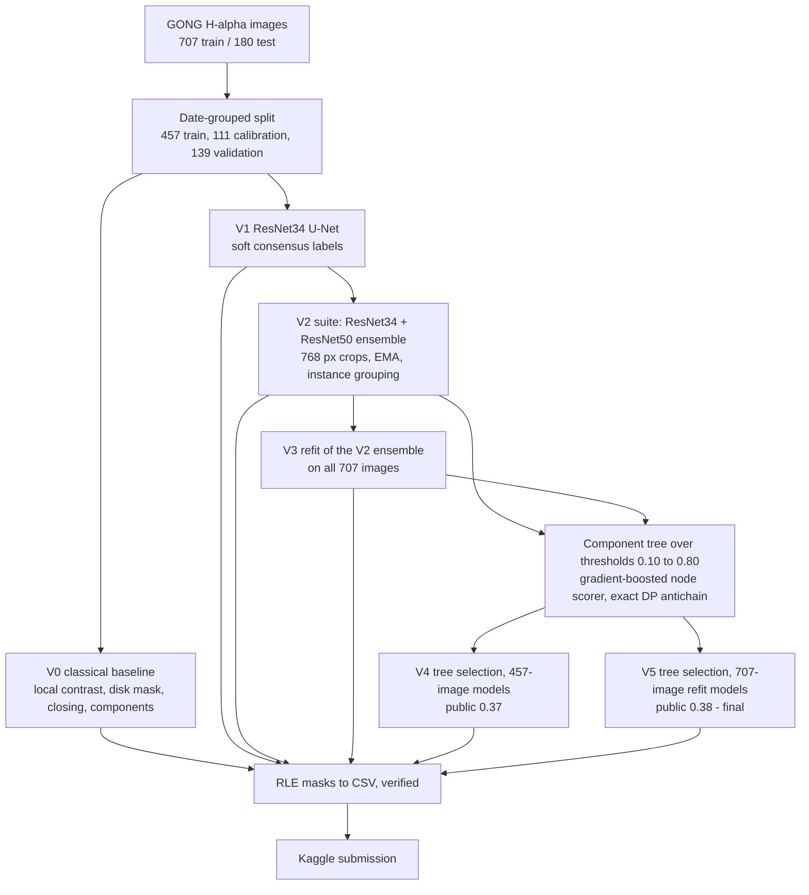

# Solar Filament Segmentation Challenge 2026

Sijan Regmi's entry (Kaggle `sijanregmi`) to the [Solar Filament Segmentation Challenge 2026](https://www.kaggle.com/competitions/filament-segmentation-2026): automatic instance segmentation of solar filaments in GONG H-alpha images. The one-page project overview is in [`docs/project-overview.pdf`](docs/project-overview.pdf); the technical report of the final entry is [`report/main_gpu.pdf`](report/main_gpu.pdf).

## About the project

**Solar filaments.** A solar filament is a long, thin, dark structure of cool, dense plasma held above the Sun's surface by magnetic fields. In H-alpha light (a red wavelength emitted by hydrogen) it appears as a dark thread against the bright solar disk; the same structure seen at the Sun's edge is called a prominence. When the supporting magnetic field becomes unstable a filament can erupt and help launch a coronal mass ejection, which can disturb satellites, communications and power grids, so detecting and tracking filaments supports space-weather research.

**The task.** Build an automatic method (computer vision, with or without learning) that outputs one pixel mask per filament in each full-disk H-alpha image from the GONG network. Data: 707 labelled training images (8,199 hand-drawn filament annotations, some images annotated by several people) and 180 test images. Submissions are a CSV of `filament_id,segmentation_rle`, one row per predicted filament. The metric is micro Panoptic Quality: a prediction matches an annotated filament only if IoU is above 0.5, and PQ = sum of matched IoU / (TP + 0.5 FP + 0.5 FN), pooled over all annotator records. Participants also publish their code and file a short technical report. Deadline: November 15, 2026 (11:59 pm CDT).

## Workflow and versions



Protocol for every learned version: models train on the 457 training-minus-calibration images; checkpoints, post-processing and candidate choice use the 111 calibration images only; the 139 validation images are scored once. Capture dates never straddle partitions. Refits use all 707 labelled images and have no held-out score.

| Version | What it is | Validation PQ | Public score |
|---|---|---|---|
| V0 classical baseline | Gaussian local contrast, solar-disk mask, morphological closing, connected components (no pretrained weights) | 0.1796 | 0.15 |
| V1 U-Net | One ImageNet-pretrained ResNet34 U-Net, soft consensus labels, tuned hysteresis thresholds | 0.4111 | 0.33 |
| V2 ensemble | ResNet34 + ResNet50 U-Nets (768 px crops, EMA), instance grouping, tuned on calibration | 0.4271 | 0.35 |
| V3 refit | Same V2 ensemble retrained on all 707 images, fixed-rule post-processing | no held-out data | 0.36 |
| V4 tree selection (457-image models) | Learned component-tree candidate selection on the V2 maps | 0.4404 | 0.37 |
| **V5 tree selection (707-image refit models), final** | Same selector applied to the refit models' maps (scorer applied to a shifted map distribution, unvalidated) | 0.4404 (V4's) | **0.38** |

Public scores use about half of the test set and two decimals; the local-to-public gap is about 0.07 to 0.08. Details and caveats are in [`docs/dl-extension.md`](docs/dl-extension.md).

## Methods, computer vision and pretrained models

- **Classical computer vision (V0):** Gaussian local-contrast filtering, solar-disk masking, thresholding, morphological closing, connected-component labelling with area and elongation filters.
- **Deep learning (V1 to V5):** U-Net segmentation with ResNet34 and ResNet50 encoders, probability-map ensembling, then classical post-processing (hysteresis thresholds, instance grouping, component trees, RLE encoding).
- **Learned selection (V4, V5):** a gradient-boosted regressor (scikit-learn) scores every node of a component tree by expected matched IoU; the expected-PQ-maximizing set of non-overlapping nodes is found exactly by dynamic programming. Offsets are chosen by out-of-fold cross-fitting on calibration.
- **Pretrained models:** the ResNet34 and ResNet50 encoders start from ImageNet weights (torchvision); decoders are trained from scratch and everything is fine-tuned on the competition images. The tree scorer is fitted only on this project's maps. No external solar data was used. The competition rules allow free, publicly available pretrained models, and the report discloses them.

## Submission status

**Final entry (October 17, 2026):** V5, the tree-selection ensemble on the 707-image refit models (public **0.38**, CSV SHA-256 prefix `2a01f6e0`), with V4 (public **0.37**, prefix `8c900861`) as the second Kaggle final selection. Validation PQ of the tree selection is 0.4404 against 0.4271 for the fixed rule on the same maps. Leaderboard position when checked on October 17, 2026: about 230th of 1,054 teams. The report is `report/main_gpu.pdf` (4 pages). Records: `docs/submission-status.json`. AI assistance was used for implementation and documentation; the participant remains responsible for understanding and defending the method.

Earlier entries: the classical baseline (`results/submission.csv`) was accepted on September 23, 2026 (public 0.15) and is no longer selected; the later versions are listed in the table above.

Public source: https://github.com/regmi-sijan/solar-filament-segmentation-2026 (final code on branch `gpu-unet-extension`).

Public Kaggle notebook (classical baseline): https://www.kaggle.com/code/sijanregmi/solar-filament-cpu-baseline-reproducible. Version 1 ran successfully on free CPU and reproduced the accepted CSV byte-for-byte (SHA-256 `65ec7be6fdc2d0a3a47675b897b55fb13506dcc68951de209227065edbba69ab`). The GPU notebooks (`notebooks/gpu-*.ipynb`) are run privately on Kaggle; their code is in this repository. Trained weights are not stored in git; the notebooks recreate them.

`notebooks/kaggle-inference.ipynb` is a self-contained baseline inference notebook; the full calibration and evaluation notebook is `notebooks/competition-pipeline.ipynb`.

## Repository map

- `filament/`: classical pipeline, deep-learning code (`run_dl`, `suite`) and `treesel.py` (tree selection)
- `notebooks/`: baseline notebooks and the GPU notebooks `gpu-unet-training`, `gpu-experiments-v2`, `gpu-refit-707`, `gpu-treesel`
- `report/`: `main.pdf` (classical report), `main_gpu.pdf` (final report)
- `docs/`: `project-overview.pdf`, `dl-extension.md`, `method-walkthrough.md`, `requirements-checklist.md`, `submission-status.json`
- `results/`, `configs/`, `tests/`, `scripts/`: baseline outputs, split, tests and notebook/report builders

The sections below describe how to install, reproduce and rebuild the classical baseline (V0).

## Setup

Tested with Python 3.14 on ARM64 macOS with 16 GiB RAM. Install the exact packages in a dedicated environment:

```sh
python3 -m venv .venv
source .venv/bin/activate
python -m pip install -r requirements.txt
```

Download the competition archive after accepting Kaggle's rules. Extract it at the repository root:

```
MAGFiLO_1.0_Kaggle_2026/
  train/train_images/
  train/MAGFiLO_1.0_Annotations_kaggle2026_train.json
  test/test_images/
```

Data source: https://www.kaggle.com/competitions/filament-segmentation-2026/data
The images and labels are not redistributed in this repository. Their CC BY-NC 4.0 terms are separate from source-code licensing.

## Reproduce the submitted predictions

```sh
python -m filament.run predict
python -m filament.run verify
```

The saved `configs/model.json` is the complete model: no weights, training service, network call, or other external file is required. `results/submission.csv` has `filament_id,segmentation_rle`; `results/inference-manifest.json` lists all processed images. Verification decodes and re-encodes each mask. An image with zero retained instances has no CSV row, not a fake mask.

## Reproduce parameter calibration and validation

```sh
python -m filament.run split
python -m filament.run calibrate-initial
python -m filament.run calibrate
python -m filament.run evaluate
python -m unittest discover -s tests -v
```

Calibration searches 32 initial and 64 refinement configurations on 111 images from the development partition. The 139-image validation partition is grouped by capture date and stratified by year. Do not tune on it after reviewing the reported result without designating it development data and creating a new holdout. Runtime depends on hardware; full calibration takes several minutes on the reference laptop. Commands accept `--data /path/to/MAGFiLO_1.0_Kaggle_2026`.

Run `python scripts/execute_notebook.py` to execute the supplied plain-Python notebook cells and save outputs without a local Jupyter server. The notebook also works interactively in Jupyter.

`notebooks/competition-pipeline.ipynb` demonstrates all stages and includes executed validation and inference. Recalibration is opt-in because the chosen parameters and all search results are already saved. The official self-evaluation notebook is retained locally as a reference, attributed to Azim Ahmadzadeh; our tests compare metric semantics against its definitions. It is not redistributed in the source release; the optional parity check skips when the reference notebook is absent.

## Report and figures

```sh
python scripts/make_figures.py
python scripts/build_report.py
cd report
pdflatex -interaction=nonstopmode -halt-on-error main.tex
bibtex main
pdflatex -interaction=nonstopmode -halt-on-error main.tex
pdflatex -interaction=nonstopmode -halt-on-error main.tex
```

The LaTeX report follows the organizers' acmart/sigconf template and preserves its fixed subtitle, introduction, and acknowledgment. A TeX distribution with acmart is needed only to rebuild the PDF; it is not needed for inference. Template source: https://www.overleaf.com/read/vjztpvrnbrdh#43fbbe

## Outputs and limitations (classical baseline V0)

Frozen-configuration validation: **PQ 0.1796**, with a date-cluster bootstrap 95% interval of **0.1602–0.1992**, on 139 source images and 222 annotation sets. This is a working baseline, not a state-of-the-art claim.

See `results/validation.json` for measured PQ and uncertainty, `results/calibration.json` for all search trials, and `results/submission-verification.json` for the CSV checksum. Local validation is not a Kaggle leaderboard result. No leaderboard score should be inferred from it.

See `docs/method-walkthrough.md` for an explanation of the method and its weaknesses, and `docs/requirements-checklist.md` for competition requirements. AI assistance was used for implementation and documentation. The participant remains responsible for understanding and defending the method.

## Competition references

- https://www.kaggle.com/competitions/filament-segmentation-2026
- https://www.kaggle.com/code/azimahmadzadeh/self-evaluation-notebook
- https://doi.org/10.1038/s41597-024-03876-y

The required submission and public code-sharing steps are complete; final judging remains with the organizers.
